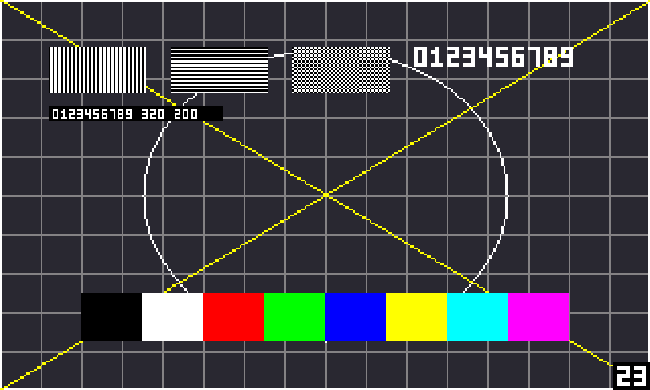
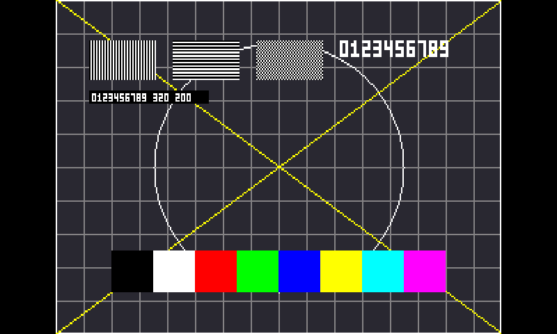

# Doom on the ESP32-S31-Korvo-1 👹

[fbDOOM](https://github.com/maximevince/fbDOOM) at commit `17280163`, patched for this board. fbDOOM draws straight to the Linux framebuffer and reads the keyboard from the console, so it needs nothing but libc - which suits a board with no SDL, no X and very little memory.

## Where it's at

| Build | What it adds | State |
|-------|--------------|-------|
| [v1](v1/) | Clean exits, the console handed back afterwards, and much faster drawing. The picture is doubled to 640x400 and centred. | Runs on the board: 18 fps in `-timedemo demo1` with `-mb 4`. |
| [v2](v2/) | Everything in v1, plus a picture that fills the 800x480 panel, a USB mouse, an fps counter and a proper quit key. | Built, and tested under emulation with 155 checks. Not yet run on the board. |

The v2 patch includes v1, so you only ever apply one of them.

## Why stock fbDOOM needed patching

It works out of the box on plenty of boards, but a few things hurt on one where the LCD is the only console:

- A fatal error prints its message and then spins forever, with the keyboard stuck in raw mode and Ctrl+C switched off.
- Backspace quits on the spot, even in the middle of a menu.
- It never tells the console to stop drawing, so the cursor and kernel messages land on top of the game.
- It builds each frame a byte at a time and pushes it through `write()`, which is slow when every store goes out to PSRAM.

## What the picture looks like

The v2 scaler, shown with a test card rather than the game. Left is the default, stretched to fill the panel, with the fps counter in the corner. Right is `-aspect`, which keeps Doom's 4:3 shape.

| Default (fills 800x480) | `-aspect` (640x480) |
|---|---|
|  |  |

Filling an 800x480 screen from 320x200 means pixels come out 2 or 3 panel pixels wide by turns. `-aspect` keeps them even.

## Running it

Build it from [v2/BUILD.txt](v2/BUILD.txt) (or [v1/BUILD.txt](v1/BUILD.txt)), copy it and your WAD to the card, then:

```sh
/root/fbdoom2 -iwad /mnt/sd/doom1.wad -mb 4
```

| Option | What it does |
|--------|--------------|
| `-mb N` | Size of Doom's heap in MB. The default is 6; 4 leaves the board more room. |
| *(none)* | v2: fill the screen. |
| `-aspect` | v2: the largest 4:3 picture that fits, centred. |
| `-scaling N` | Whole-number scaling, centred. `-scaling 2` is the v1 picture. |
| `-showfps` | v2: draw the frame rate in the bottom right corner. |
| `-nomouse` | v2: don't look for a mouse. |
| `-novert` | v2: stop the mouse walking you forwards and backwards. |
| `-timedemo demo1` | Play the first demo flat out and print the frame rate at the end. |

### Keys

| Key | Does |
|-----|------|
| Arrows | Move and turn |
| Ctrl | Fire |
| Alt | Strafe, held with left and right |
| Space | Open doors, use |
| Shift | Run |
| Esc | Menu |
| Backspace | v2: back one level in the menus. In v1 it quits on the spot. |
| Ctrl+Alt+Backspace | v2: quit straight away, from anywhere |

In v1 only the left Ctrl and Alt work, and there's no mouse. In v2 the mouse turns you, the left button fires and the right button strafes.

## Good to know

- No sound. The board doesn't have any.
- Settings aren't kept between runs - this port has the config file code compiled out. Saved games are kept.
- `-timedemo` plays the whole demo before it tells you anything, and at this speed that's a few minutes.
- If the kernel kills the game for running out of memory, the console stays dead until a reboot. Start with `-mb 4`.
- A mouse has to be plugged in before the game starts.

## Testing

[v2/TEST-PLAN.txt](v2/TEST-PLAN.txt) walks through a first run on the board, safest steps first, with how to get back to v1.

[v2/tests/](v2/tests/) has the checks that run under `qemu-riscv32-static`: the scaler against a fake framebuffer, the mouse reader against fake devices, and every way out of the game against a fake console. `run-tests.sh` expects `SRC` to point at a patched `fbdoom` directory and `M` at the Buildroot output.

## Checking a build

Both builds are reproducible with the same toolchain: a fresh clone plus the patch gives these bytes.

| Build | Size | SHA-256 |
|-------|-----:|---------|
| v1 `fbdoom-korvo` | 421,304 | `8f89edfeb5c8933eb0d824e68cd73b0634c41e1ed5a18cfa88737fbcfc99a1f0` |
| v2 `fbdoom-korvo-v2` | 429,496 | `f92c004690995d52a8ee0eb2d0a4844403037e22149df8e5997fea0fde82b3aa` |
